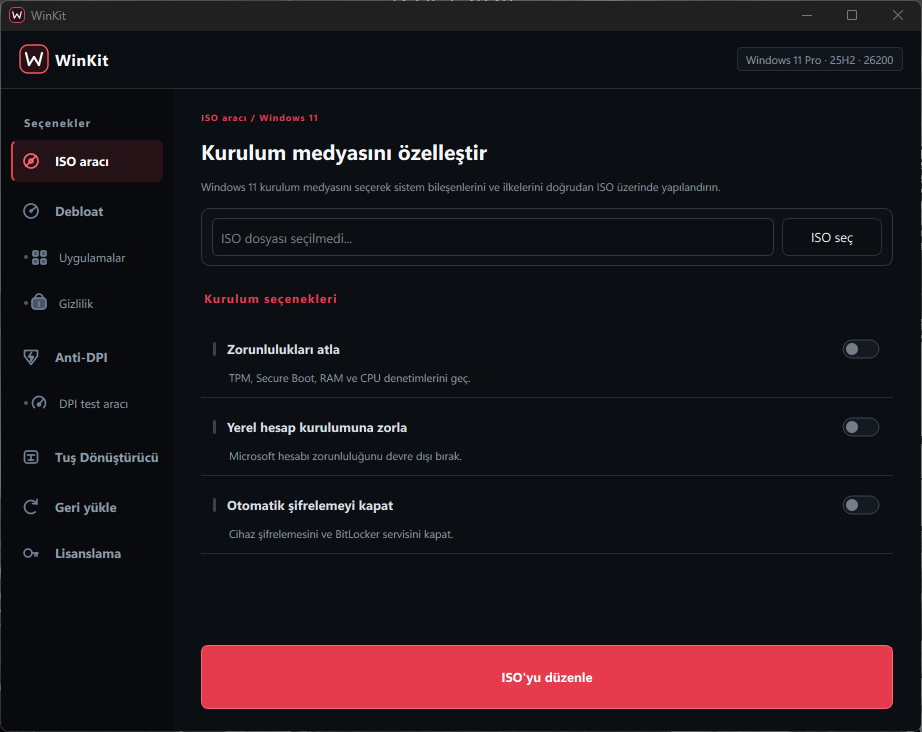
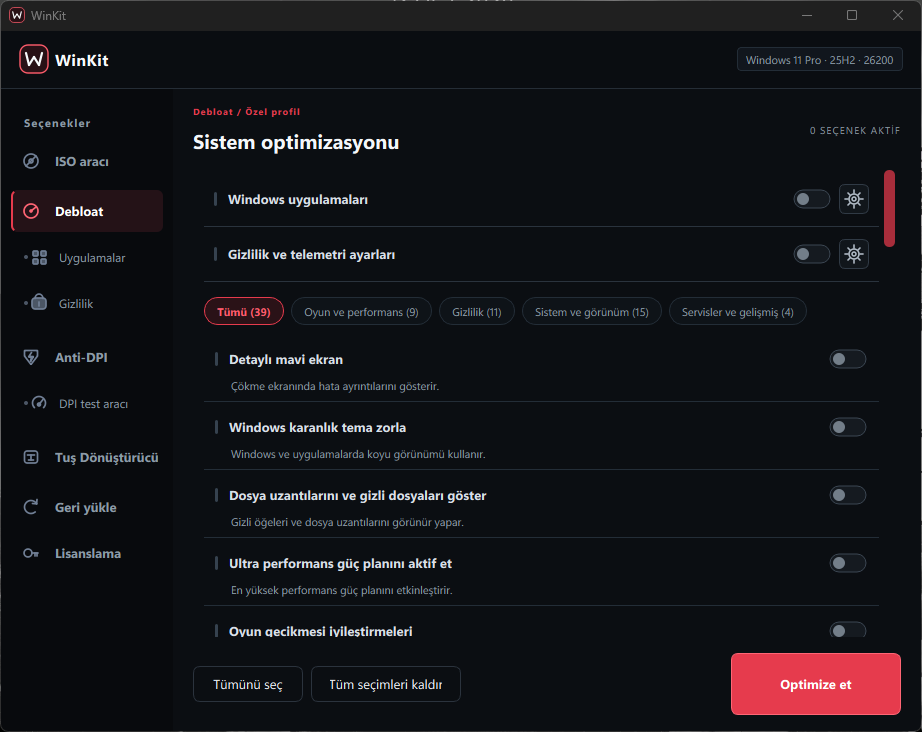
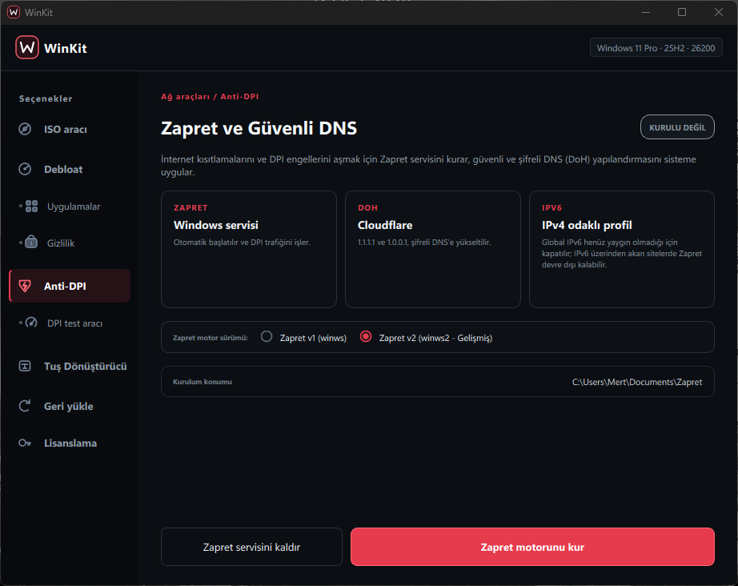
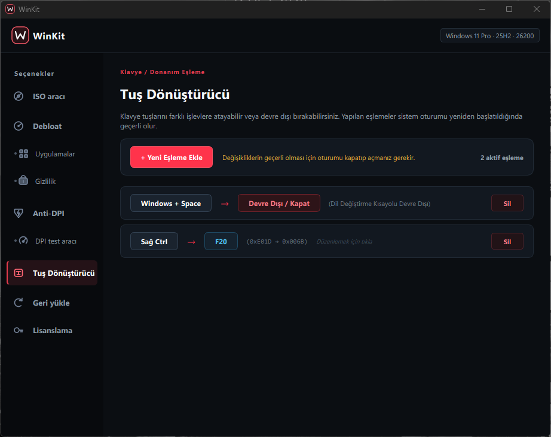
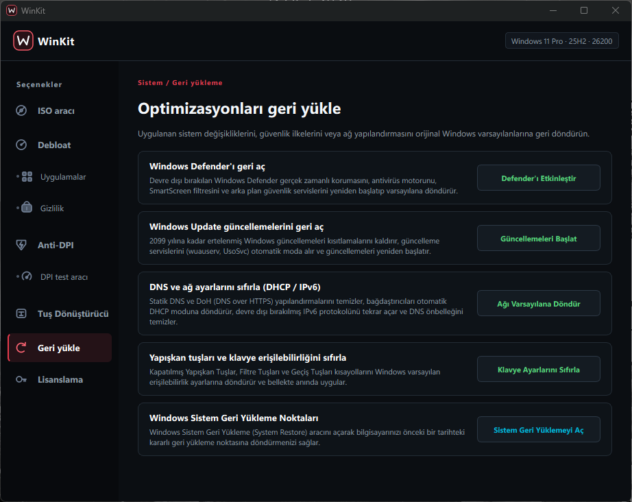
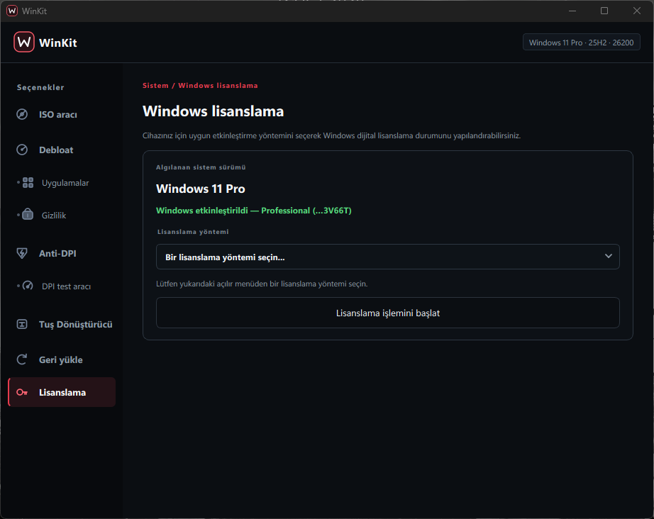

# WinKit

<div align="center">


### Windows 11 (25H2) Sistem İyileştirme, Debloat, Anti-DPI ve İnce Ayar Paketi

[-0078D6?style=flat-square&logo=windows)](https://www.microsoft.com)
[](https://www.python.org/)
[](https://riverbankcomputing.com/software/pyqt/)
[](LICENSE)

</div>

---

## Proje Hakkında

WinKit, Windows 11 25H2 (Build 26200+) işletim sistemi mimarisi hedeflenerek geliştirilmiş; telemetri tasfiyesi, sistem debloat işlemleri, DPI engeli aşma (Anti-DPI) ve düşük seviyeli Windows ince ayarlarını tek bir merkezde toplayan açık kaynaklı bir sistem yönetim aracıdır.

Yazılım, üçüncü taraf kabuk komutlarına bağımlılığı asgari düzeyde tutarak düşük seviyeli Windows API'leri (`winreg`, `ctypes`, `WMI`, `TrustedInstaller` token manipülasyonu) ve donanım hızlandırmalı PyQt6 grafik motoru üzerinde inşa edilmiştir.

---

## Modüller ve Arayüz

### 1. ISO Aracı ve Katılımsız Kurulum Medyası Düzenleyici

Windows 11 25H2 kurulum medyalarını doğrudan ayrıştırarak katılımsız kurulum (`autounattend.xml`) kurallarını enjekte eder:
* **Donanım Zorunluluklarını Atlama:** TPM 2.0, Secure Boot, RAM ve işlemci kontrollerini kurulum anında devre dışı bırakır.
* **Yerel Hesap Zorlama:** OOBE (Out-of-Box Experience) aşamasındaki zorunlu internet bağlantısı ve Microsoft hesabı dayatmasını aşar.
* **Cihaz Şifrelemesini Kapatma:** Otomatik BitLocker ve sürücü şifreleme süreçlerini devre dışı bırakarak disk performansını ve veri erişilebilirliğini korur.

<div align="center">
  
</div>

<br/>

### 2. Sistem Debloat ve Performans İnce Ayarları

Windows 11 25H2 ile birlikte gelen gömülü telemetri mekanizmalarını, reklam alanlarını ve arka plan servislerini StateRepository veritabanı düzeyinde temizler:
* **Uygulama Tasfiyesi:** Cortana, OneDrive, Copilot, MSN servisleri, Xbox altyapısı ve sponsorlu OEM uygulamalarını kalıcı olarak kaldırır.
* **Görünüm ve Çekirdek Ayarları:** Detaylı mavi ekran (BSOD hata ayrıntıları), Windows karanlık tema zorlaması ve dosya uzantılarının görünürlüğü.
* **Oyun ve Gecikme Optimizasyonları:** Fullscreen Optimizations (FSO), Multi-Plane Overlay (MPO) ve Ultra Performans Güç Planı yapılandırmaları.
* **Dinamik Çip Filtreleme:** Ayarlar arasında hızlı geçiş sağlayan durum odaklı filtreleme mimarisi (Oyun ve Performans, Gizlilik, Sistem ve Görünüm, Servisler ve Gelişmiş).

<div align="center">
  
</div>

<br/>

### 3. Anti-DPI ve Güvenli DNS Motoru (Zapret & DoH)

Derin Paket İnceleme (DPI) sansür mekanizmalarını donanım seviyesinde aşmak ve güvenli ağ trafiği sağlamak için geliştirilmiş ağ modülü:
* **Zapret Servis Entegrasyonu:** `winws` (V1) ve `winws2` (V2 - Gelişmiş) motorlarını kalıcı bir Windows servisi olarak yapılandırır.
* **Şifreli DNS (DoH):** Cloudflare DNS-over-HTTPS (1.1.1.1 & 1.0.0.1) şablonlarını doğrudan ağ bağdaştırıcılarına tanımlar.
* **IPv4 Odaklı Profil:** IPv6 kaynaklı sızıntıları ve DPI filtreleme bypass problemlerini önlemek için otomatik ağ adaptasyonu uygular.
* **DPI Test Aracı (BlockCheck):** Sansürlü hedeflere yönelik paket parçalama stratejilerini gerçek zamanlı olarak test eder.

<div align="center">
  
</div>

<br/>

### 4. Tuş Dönüştürücü (Kernel Scancode Mapping)

Windows çekirdeğinde (`HKLM\SYSTEM\CurrentControlSet\Control\Keyboard Layout\Scancode Map`) düşük gecikmeli donanımsal tuş eşlemesi sağlar:
* **Kısayol İptali:** Windows 11 üzerinde sık karşılaşılan istenmeyen dil değiştirme kısayolunu (`Windows + Space`) sıfır gecikmeyle iptal eder.
* **Donanım Tuş Eşleme:** Donanım seviyesinde tuş atamaları tanımlar (örneğin Sağ Ctrl tuşunu F20 veya başka bir fonksiyona yönlendirme).
* **Oturum Entegrasyonu:** Arka planda çalışan sürekli bir hook mekanizmasına ihtiyaç duymadan, doğrudan Windows çekirdek eşlemesiyle çalışır.

<div align="center">
  
</div>

<br/>

### 5. Geri Yükleme ve Sistem Varsayılanlarına Dönüş

Yapılan tüm çekirdek müdahalelerini, politika kısıtlamalarını ve ağ yapılandırmalarını güvenle geri alır:
* **Windows Defender:** Kapatılan gerçek zamanlı korumayı, filtre sürücülerini ve güvenlik servislerini yeniden başlatır.
* **Windows Update:** 2099 yılına kadar duraklatılmış güncelleme kısıtlamalarını kaldırarak `wuauserv` ve `UsoSvc` servislerini otomatik moda alır.
* **Ağ ve DNS Sıfırlama:** DoH ve statik IP/DNS yapılandırmalarını temizler; bağdaştırıcıları fabrika çıkışı DHCP moduna döndürür.
* **Erişilebilirlik Sıfırlama:** Kapatılmış Yapışkan Tuşlar ve klavye kısayollarını varsayılana getirir.
* **Sistem Geri Yükleme:** Değişiklikler öncesinde ve sonrasında Windows Sistem Geri Yükleme Noktası oluşturur.

<div align="center">
  
</div>

<br/>

### 6. Windows Lisans Durumu ve Teşhisi

Sistem lisans durumunu yerel Windows Management Instrumentation (WMI) üzerinden doğrudan sorgular:
* **WMI Sorgulama:** `SoftwareLicensingProduct` sınıfı üzerinden ApplicationID filtrelemesi ile gerçek lisans durumunu, SKU kimliğini ve kısmi anahtar bilgisini okur.
* **SPP Altyapısı:** Yazılım Koruma Platformu (Software Protection Platform) yapılandırmasını görüntüler.

<div align="center">
  
</div>

---

## Mimari Yapı

```
WinKit/
├── core/                   # Düşük Seviyeli Sistem Mühendisliği Motoru
│   ├── anti_dpi.py         # Zapret V1/V2 servis ve ağ şablon yöneticisi
│   ├── appx_manager.py     # AppX paket listesi ve durum analizcisi
│   ├── cli.py              # Konsol / CLI kontrolcüsü
│   ├── constants.py        # Win32 sabitleri ve bayrak tanımları
│   ├── context_menu.py     # Windows 10/11 sağ tık kayıt defteri entegrasyonu
│   ├── debloater.py        # StateRepository SQLite ve AppX derin temizleme
│   ├── defender.py         # Windows Defender ve minifilter sürücü kontrolü
│   ├── dpi_tester.py       # Soket tabanlı sansür analiz motoru
│   ├── edgewebview.py      # Edge ve WebView2 ilişkilendirme kontrolü
│   ├── iso.py              # ISO unpack, autounattend.xml ve repack motoru
│   ├── key_remap.py        # Scancode Map kayıt defteri eşleyicisi
│   ├── licensing.py        # WMI lisans sorgulama ve SPP modülü
│   ├── orchestrator.py     # İş parçacığı ve görev kuyruğu yöneticisi
│   ├── privileges.py       # RtlAdjustPrivilege ve TrustedInstaller token çoğaltıcı
│   ├── registry.py         # Atomik winreg kayıt defteri yöneticisi
│   ├── restore.py          # Sistem geri yükleme noktası motoru
│   ├── scanner.py          # Kalıntı dizin ve dosya tarayıcısı
│   ├── shutup10.py         # O&O ShutUp10 kural ayrıştırıcısı
│   ├── system.py           # Donanım, mimari ve yol yardımcıları
│   └── tweaks.py           # Performans, FSO, MPO ve telemetri ilkeleri
│
├── gui/                    # PyQt6 Donanım Hızlandırmalı Grafik Katmanı
│   ├── app.py              # Ana uygulama penceresi, sayfa yönlendiricisi ve işçiler
│   ├── widgets.py          # Özel kartlar, animasyonlu switchler ve filtre çipleri
│   ├── dialogs.py          # Modal pencereler ve ilerleme bildirimleri
│   └── styles.py           # Koyu tema QSS stil tanımlamaları
│
├── zapret/                 # Anti-DPI ikilileri, sürücüler ve kural setleri
├── winkit_main.py          # Uygulama ana giriş noktası (GUI / CLI)
├── compile.bat             # PyInstaller tek parça derleme betiği
└── kur_gereksinimler.bat   # Python ortam gereksinimleri yükleyicisi
```

---

## Sistem Uyumluluğu

* **Hedef İşletim Sistemi:** Yalnızca **Windows 11 (25H2 / 24H2 - 64-bit)**
* **Not:** Windows 10 veya eski Windows sürümleri mimari olarak hedeflenmemektedir. Kod tabanı Windows 11 25H2 servis yapısına ve kayıt defteri hiyerarşisine göre optimize edilmiştir.
* **Gerekli İzinler:** Yerel Yönetici (Local Administrator) ayrıcalıkları zorunludur (UAC ile otomatik yükseltilir).

---

## Kurulum ve Çalıştırma

### Kaynak Koddan Çalıştırma

Geliştirme ve inceleme amacıyla doğrudan Python ortamından çalıştırmak için:

```powershell
# 1. Depoyu yerel ortama çekin
git clone https://github.com/Mazi0182/WinKit.git
cd WinKit

# 2. Gereksinimleri yükleyin
pip install -r requirements.txt
# alternatif: .\kur_gereksinimler.bat

# 3. Yönetici ayrıcalıklarıyla başlatın
python winkit_main.py
```

### Bağımsız EXE Olarak Derleme

Projeyi tek bir taşınabilir `.exe` (`dist\winkit.exe`) haline getirmek için:

```powershell
.\compile.bat
```

---

## Komut Satırı Arayüzü (CLI)

WinKit, grafik arayüze ihtiyaç duymadan doğrudan terminal üzerinden veya otomasyon betiklerinden yürütülebilir:

```powershell
# Komut listesi ve yardım
python winkit_main.py --help

# Sessiz debloat ve telemetri temizliği
python winkit_main.py --debloat

# Ağ ve DNS yapılandırmasını DHCP varsayılanlarına sıfırlama
python winkit_main.py --test-dns-reset
```

---

## Üçüncü Taraf Araçlar ve Telif Hakları (Third-Party Credits)

WinKit bünyesinde kullanılan harici bileşenler ve hak sahipleri:

* **O&O ShutUp10++:** O&O Software GmbH tarafından sağlanan ücretsiz güvenlik ve gizlilik aracıdır. WinKit, telemetri politikalarını uygulamak için bu bileşenden yararlanır. [oo-software.com](https://www.oo-software.com/en/shutup10)
* **oscdimg:** Microsoft Corporation tarafından sağlanan Windows ADK önyüklenebilir ISO üretim aracıdır. [learn.microsoft.com](https://learn.microsoft.com/en-us/windows-hardware/manufacture/desktop/oscdimg-command-line-options)
* **7-Zip:** Igor Pavlov tarafından geliştirilen GNU LGPL lisanslı arşivleme aracıdır. [7-zip.org](https://www.7-zip.org/)
* **Zapret & WinDivert:** bol-van ve Basil Vadimovich tarafından geliştirilmiş açık kaynaklı paket manipülasyon ve Anti-DPI motorudur. [github.com/bol-van/zapret](https://github.com/bol-van/zapret)
* **Microsoft Activation Scripts (MAS):** Massgrave ekibi tarafından geliştirilen açık kaynaklı Windows lisans durumu ve SPP yöntemleri referans alınmıştır. [github.com/massgravel/Microsoft-Activation-Scripts](https://github.com/massgravel/Microsoft-Activation-Scripts)

---

## Sorumluluk Reddi (Disclaimer)

WinKit; Windows 11 kayıt defteri anahtarlarına, çekirdek servislerine ve güvenlik bileşenlerine doğrudan müdahale eden bir sistem mühendisliği aracıdır.

Yazılım **olduğu gibi (AS IS)** sunulmakta olup, kullanımından kaynaklanabilecek sistem kararsızlıkları veya veri kayıplarından son kullanıcı sorumludur. İşlem yapmadan önce dahili Geri Yükleme modülü üzerinden Sistem Geri Yükleme Noktası oluşturulması tavsiye edilir.

---

## Lisans

Bu proje [MIT Lisansı](LICENSE) kapsamında lisanslanmıştır.
